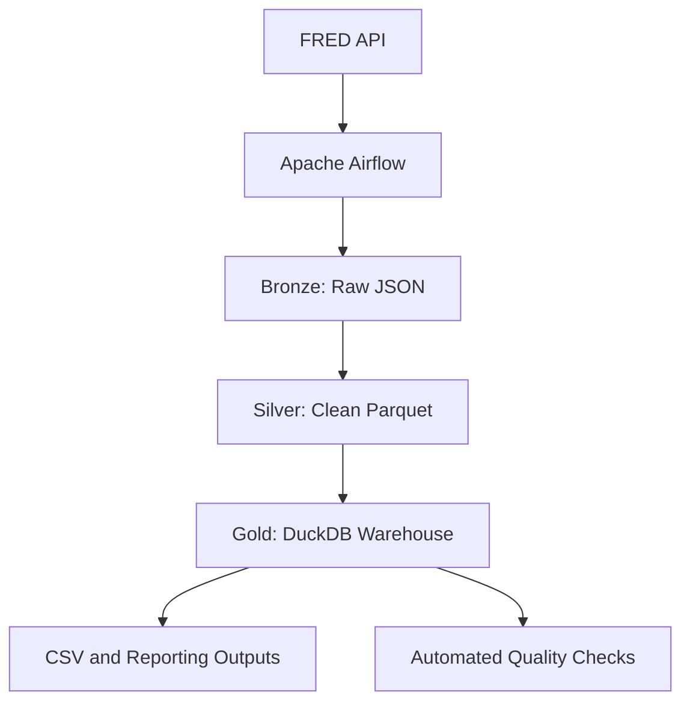

# MacroPulse-Event-Driven-Economic-Intelligence-Platform
# MacroPulse: Economic Intelligence Pipeline

An event-driven data engineering platform that ingests U.S. economic indicators from the Federal Reserve Economic Data (FRED) API, processes them through Bronze, Silver, and Gold layers, validates data quality, and produces analytics-ready outputs.


### Successful Airflow Orchestration
Pipeline Demonstration
1. End-to-End Airflow Orchestration
airflow-dags-overview.png
The Airflow environment shows successful ingestion, warehouse, and reporting workflows, demonstrating automated data movement from FRED through the complete analytics pipeline.

2. Dynamic Task Mapping
dynamic-task-mapping.png
Airflow dynamically created individual fetch tasks for each configured FRED indicator, allowing multiple economic series to be processed efficiently.

3. Bronze and Silver Validation
bronze-silver-validation.png
DuckDB confirmed that HOUST landed with 813 observations and was standardized as a monthly series covering January 1959 through September 2026.

4. Gold Series Dimension
gold-series-dimension.png

The Gold warehouse assigned analytical surrogate keys to every indicator, with HOUST receiving series_key = 9 after the dimension rebuild.

5. Quarterly Fact Validation
quarterly-facts.png
The quarterly fact table contains complete three-month HOUST aggregates, including a 2026-Q3 average value of 1292.7.

6. Wide Reporting Table
quarterly-wide-table.png
The wide reporting table transforms Gold-layer quarterly facts into a dashboard-friendly structure with one column for each economic indicator.

7. Automated Reporting Tasks
reporting-tasks.png
After the Gold warehouse was published, Airflow automatically executed the CSV export and dashboard-building tasks.

8. Successful DAG Run History
dag-run-history.png
The run history confirms successful manual, scheduled, and asset-triggered executions across the ingestion, warehouse, and reporting workflows.

## Airflow Pipeline Evidence

### Gold Warehouse Workflow


*The warehouse DAG successfully built the Gold analytical tables, ran the required data-quality checks, and published the Gold asset for downstream reporting.*

---

### Task Performance Monitoring


*Airflow recorded successful task instances with short execution times and zero failed task instances.*

---

### Automated Reporting Workflow


*The reporting DAG automatically exported the reporting dataset and rebuilt the dashboard after receiving the Gold asset.*

---

### Asset-Triggered Warehouse Runs


*The warehouse completed three successful runs and automatically triggered the downstream reporting DAG through published asset events.*

---

### Incremental Series Selection


*The series-selection task completed successfully across scheduled and manual runs, demonstrating reliable incremental ingestion behavior.*


### Automated Reporting Workflow


## Project Overview

MacroPulse demonstrates how economic data can be collected, transformed, validated, and published through an automated data pipeline.

The project uses Apache Airflow to coordinate three connected workflows:

- `fred_ingest` retrieves economic data and creates the Bronze and Silver layers.
- `fred_warehouse` builds analytical Gold tables and runs data-quality checks.
- `fred_reports` exports reporting data and refreshes downstream outputs.

The pipeline was extended with **HOUST**, the FRED series for new privately owned housing units started, to demonstrate configuration-driven onboarding and incremental ingestion.

## Business Problem

Economic analysts frequently combine indicators such as housing activity, inflation, employment, interest rates, and consumer spending. Manually downloading and preparing these datasets is repetitive and can introduce inconsistent calculations.

MacroPulse provides a repeatable process that:

- Retrieves economic data automatically
- Preserves the original source data
- Standardizes observations and metadata
- Produces monthly and quarterly analytical tables
- Detects missing or inconsistent data
- Publishes reporting-ready outputs

## Architecture



## Key Features

- Configuration-driven indicator onboarding
- Incremental and full-refresh ingestion modes
- Dynamic Airflow task mapping
- Bronze, Silver, and Gold data architecture
- Native monthly and aggregated quarterly facts
- DuckDB analytical warehouse
- Automated data-quality validation
- Asset-triggered workflow orchestration
- Docker-based reproducible environment
- Reporting-ready wide and long tables

## Verified Results

| Metric | Result |
|---|---:|
| Configured economic indicators during extension | 17 |
| Silver-layer observations | 69,274 |
| HOUST historical observations | 813 |
| HOUST historical coverage | January 1959–September 2026 |
| Automated Airflow DAGs | 3 |
| Automated quality checks | 4 |
| Recent complete HOUST quarters validated | 4 |
| HOUST Gold surrogate key | 9 |

## Incremental Ingestion Demonstration

HOUST was added through a single configuration entry:

```json
{
  "id": "HOUST",
  "name": "Housing Starts",
  "category": "Housing",
  "frequency": "monthly",
  "aggregation_method": "avg"
}
```

With full refresh disabled, the pipeline identified HOUST as the only new series:

```text
Selected 1 of 17 series: ['HOUST']
Landed HOUST: 813 observations.
Fetched this run: ['HOUST']
Silver row counts: {'series': 17, 'observations': 69274}
```

This demonstrated that the pipeline could onboard a new indicator without downloading the complete history of every existing series.

## Data Layers

### Bronze Layer

The Bronze layer preserves the original FRED observations and ingestion metadata.

Recorded information includes:

- Series identifier
- Ingestion date
- Airflow run identifier
- Retry number
- Observation count
- Original FRED response

### Silver Layer

The Silver layer validates and standardizes the source data into Parquet datasets.

For HOUST, the Silver layer confirmed:

- Frequency: Monthly
- Aggregation method: Average
- Units: Thousands of Units
- Observation count: 813
- Date range: 1959-01-01 through 2026-09-01

### Gold Layer

The Gold layer provides analytics-ready warehouse tables:

- Series dimension
- Date and quarter dimensions
- Native monthly fact table
- Quarterly macroeconomic fact table
- Wide quarterly reporting table

## Quarterly Aggregation

HOUST is a monthly level reported as a seasonally adjusted annual rate. Therefore, the quarterly value uses the average of the three monthly observations.

| Method | 2026-Q3 result | Interpretation |
|---|---:|---|
| Average | 1292.7 | Represents the typical monthly level |
| End of period | 1221.0 | Uses September only |
| Sum | 3878.0 | Incorrectly adds three annualized levels |

## Data-Quality Checks

The warehouse automatically validates:

1. Every configured series contains observations.
2. Configured frequencies match FRED metadata.
3. Quarterly facts contain the expected number of observations.
4. The date dimension contains no gaps.

```text
Check 01_every_series_has_data passed.
Check 02_frequency_matches_fred passed.
Check 03_quarterly_grain passed.
Check 04_dim_date_has_no_gaps passed.
```

## Airflow Orchestration

The platform uses asset-driven orchestration:

```text
fred_ingest
    → publishes fred_silver
    → triggers fred_warehouse
    → publishes fred_gold
    → triggers fred_reports
```

This removes the need to manually trigger each workflow.

## Pipeline Evidence


The final workflow completed with zero failed tasks and zero failed DAG runs.

## Technology Stack

- **Apache Airflow:** Workflow orchestration
- **Python:** Ingestion and pipeline logic
- **DuckDB:** Analytical data warehouse
- **SQL:** Transformations, aggregations, and validation
- **Parquet:** Silver-layer storage
- **JSON:** Raw Bronze storage and configuration
- **Docker Compose:** Reproducible local environment
- **FRED API:** Economic data source
- **PowerShell:** Local execution and validation

## Repository Structure

```text
macropulse-economic-intelligence/
├── dags/
│   ├── config/
│   ├── sql/
│   │   ├── silver/
│   │   ├── gold/
│   │   └── checks/
│   └── pipeline/
├── docs/
│   └── images/
├── reports/
├── .env.example
├── .gitignore
├── docker-compose.yml
└── README.md
```

## Local Setup

### 1. Clone the repository

```bash
git clone https://github.com/YOUR-USERNAME/macropulse-economic-intelligence.git
cd macropulse-economic-intelligence
```

### 2. Create the environment file

Copy `.env.example` to `.env` and add your own FRED API key.

Never commit the `.env` file or API credentials.

### 3. Start the platform

```bash
docker compose up -d
```

### 4. Open Airflow

```text
http://localhost:8080
```

### 5. Enable the workflows

Unpause the following DAGs in this order:

1. `fred_warehouse`
2. `fred_reports`
3. `fred_ingest`

## Security and Repository Hygiene

The public repository excludes:

- API keys and credentials
- `.env` files
- Raw downloaded datasets
- DuckDB database files
- Airflow logs
- Temporary backups
- Instructor-owned assignment materials

## Future Roadmap

- Interactive Streamlit economic dashboard
- Economic anomaly detection
- Pipeline observability dashboard
- Automated SQL testing
- GitHub Actions integration
- Additional FRED indicators
- Cloud deployment
- Email or Slack alerts for failed quality checks

## Skills Demonstrated

- Data engineering
- Workflow orchestration
- Dimensional modeling
- ETL/ELT development
- Incremental ingestion
- Data-quality engineering
- SQL analytics
- Docker containerization
- Economic data analysis
- Technical documentation

## Author

**Faraz Ahmed Syed** 
farazsyed0811@gmail.com
M.S. Artificial Intelligence and Business Analytics  
University of South Florida

[LinkedIn](https://www.linkedin.com/in/faraz-ahmed-syed-7a8753238/)

---

This repository is a cleaned portfolio implementation. Credentials, raw data, assignment instructions, and proprietary course materials are not included.
